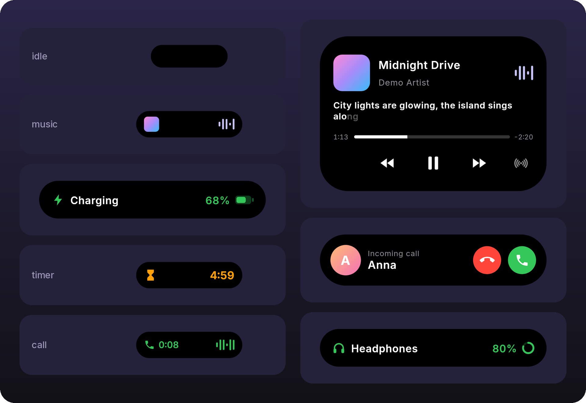

<div align="center">

# 🏝️ Dynamic Island for Android

**An iPhone-style Dynamic Island around the camera of any Android phone**

Maintainer & Developer: **McNeil Maseko**

Notifications with reply · navigation · payments · music with lyrics · calls · timers · downloads · charging · flashlight · system events

[](https://github.com/Akira9021/Dynamic-Island-/releases/latest)
<br>




[Features](#-features) · [Installation](#-installation) · [Gestures](#-gestures) · [Settings](#-settings) · [How it works](#-how-it-works)

</div>

---

## 📱 Features

<table>
<tr><th>Card</th><th>In the capsule</th><th>On tap</th></tr>
<tr><td>🎵 <b>Music</b></td><td>Artwork to the left of the camera, a sound wave in the artwork color on the right</td><td>Artwork, title, synced lyrics, seeking, ⏪ ⏸ ⏩, audio output</td></tr>
<tr><td>📞 <b>Calls</b></td><td>Incoming — avatar, name and buttons right away; during a call — a phone with the time and a wave</td><td>Name, duration, End</td></tr>
<tr><td>⏳ <b>Timer</b></td><td>An hourglass and a countdown, the last 10 seconds in red</td><td>A remaining-time ring around pause, cancel; at the end — an alarm and vibration</td></tr>
<tr><td>⏱️ <b>Stopwatch</b></td><td>Time</td><td>Pause, reset, stop</td></tr>
<tr><td>⏰ <b>Clock</b></td><td>A Clock timer or stopwatch — from the notification or, if its notifications are off, from the app's screen; screen recording in red</td><td>Large time, paused state, open the app</td></tr>
<tr><td>🌙 <b>Alarm</b></td><td>12 hours before it rings: a moon and the wake-up time; when you set an alarm — a "Wake up 7:30 · sleep 8 h 15 min" banner</td><td>An iPhone-style sleep dial: an arc from now to the alarm, the alarm time and how much sleep is left</td></tr>
<tr><td>⬇️ <b>Downloads</b></td><td>The app icon and a progress ring (Google Play, Telegram…)</td><td>Name, bar and percentage</td></tr>
<tr><td>🔦 <b>Flashlight</b></td><td>A yellow icon</td><td>A card with a beam like in iOS 18: swipe for brightness (Android 13+), tap to turn off</td></tr>
<tr><td>🔔 <b>Notifications</b></td><td>A big banner: an avatar with the app badge, the name, the text and Reply / Mark as read buttons</td><td>Reply right inside the island; tap opens the app, swipe up dismisses</td></tr>
<tr><td>🧭 <b>Navigation, rides, deliveries</b></td><td>The turn arrow and distance, for rides and deliveries — the arrival time</td><td>Where to turn, arrival time, travel time, Open</td></tr>
<tr><td>🏟️ <b>Live sports</b></td><td>Live score and team badges from Google Sports, FotMob, SofaScore, FlashScore and other supported apps</td><td>Competition, teams, score and latest match event; tap to open the source app</td></tr>
<tr><td>⚡ <b>Charging</b></td><td>A bolt, percentage and a battery</td><td>A charge bar</td></tr>
<tr><td>🕐 <b>Idle island</b></td><td>A small capsule above the camera</td><td>Clock, date, battery, a 1–99 min timer, stopwatch, flashlight</td></tr>
</table>

If there are two activities — say, music and a timer — the second one moves into a round **bubble** next to the island. Tapping the bubble expands it.

### 🔔 Events

Short notices in the capsule, each can be turned on separately:

| | | |
| --- | --- | --- |
| ⚡ Charging started / stopped | 🪫 Low battery (5%) | 📶 Wi-Fi connected / disconnected |
| 🎧 Headphones connected / disconnected (with battery) | ✈️ Airplane mode | 🔕 Ring / vibrate / silent |
| 🔆 Adaptive brightness | 🔌 USB device | 🔓 Unlock |
| 🌙 Do Not Disturb | 💳 Hold near reader | ✅ Paid |

## 📥 Installation

1. Download and install the app APK.
2. Open the app — on Home tap **Open accessibility** and turn on "Dynamic Island".
3. Home → **Permissions**: turn on **Notification access** — without it there's no music, downloads or Clock timers.
4. There, tap **Calls** and allow access to the phone, call log and contacts — then the island shows incoming calls with any dialer.
5. On Android 12+ allow **Bluetooth** to see headphone names.
6. **Appearance → Position and size** — the island turns red: move it until the red sits exactly over the camera and pick the width and height. Waterdrop camera — turn on **Like a notch**.

> [!TIP]
> If the island disappears (Xiaomi and HyperOS, Oppo, realme, Samsung, Infinix…): **Permissions → Keep the island running** — unrestricted battery, autostart and locking in recent apps.

## 👆 Gestures

| Action | Result |
| --- | --- |
| Tap | Expand (can be changed: open the app, pause, next track, nothing) |
| Double tap / long press | Configurable, long press opens the app by default |
| Pull down | Expand — the capsule follows your finger |
| Pull up, tap or touch outside | Collapse |
| Push left / right | Next / previous track |
| Tap a ringing timer | Stop the alarm |

## ⚙️ Settings

Four tabs:

- **Home** — the live preview, whether the island is on, **permissions** and **Try it**: every island demo on one screen.
- **Features** — what the island shows and how you handle it:
  - **Dynamic cards**, **notifications** and **events** — each can be turned off; notifications also have reply buttons, the number of text lines and the button color.
  - **Live sports** — match scores, team badges and recent events from Google Sports and supported score apps.
  - **Lyrics** — in the expanded player.
  - **Gestures** and **Behavior** — when to show and collapse the island, the second-activity circle, haptics, turning the screen on for a call.
  - **System banners** — shortcuts to the Android settings where you turn off pop-ups of the dialer, Clock and battery.
- **Appearance** — how the island looks:
  - **Position and size** — horizontal offset, top offset, width, height and Like a notch.
  - **Size with activity** — how much thicker and wider the capsule with an activity is than the idle one.
  - **Capsule color** — color, outline, and shadow.
  - **Liquid Glass** *(experimental)* — a glass island and cards, glass density.
  - **Island expansion** — style, duration, elasticity, Reduce effects.
  - **Effects** — blur, live equalizer, shake, payment waves, artwork glow and battery saving.
- **About** — version, instructions, navigation diagnostics, and maintainer information.

## 🧩 How it works

<details>
<summary>For developers</summary>

<br>

Kotlin, Jetpack Compose, Material 3. Requires JDK 17 and Android SDK 35.

```bash
./gradlew assembleDebug     # app/build/outputs/apk/debug/app-debug.apk — for your own phone
./gradlew assembleRelease   # app-release-unsigned.apk — release signing handled in CI
```

| File | Responsible for |
| --- | --- |
| `service/IslandService.kt` | Accessibility service and windows (drawing & touch) |
| `service/NotifListener.kt` | Notification access: calls, downloads, screen recording, timers |
| `service/MediaMonitor.kt` | Media sessions, artwork, color, lyrics |
| `service/SystemEvents.kt` | Charging, Wi-Fi, headphones, airplane mode, sound, brightness, USB, unlock |
| `service/NotifListener2.kt`, `service/SportDetector2.kt` | Live match notifications, scores and sport filtering |
| `lyrics/LyricsRepo.kt` | Lyrics from LRCLIB |
| `service/CallMonitor.kt` | Calls from phone state |
| `island/IslandOverlay.kt` | Main activity/bubble choice, shape, springs, gestures |
| `island/Compact.kt`, `Expanded.kt` | Collapsed and expanded card views |
| `ui/` | Settings app |

</details>

## 💜 Credits

Maintainer & Developer: **McNeil Maseko**.
Original behavior and concept inspired by [Dynamic Island for Windows](https://github.com/mihailkotovski/DynamicIsland) (mihailkotovski). Lyrics powered by [LRCLIB](https://lrclib.net).

<div align="center">
<sub>Font <a href="https://github.com/rsms/inter">Inter</a> — SIL OFL 1.1 · Icons <a href="https://ionic.io/ionicons">Ionicons</a> — MIT</sub>
</div>
